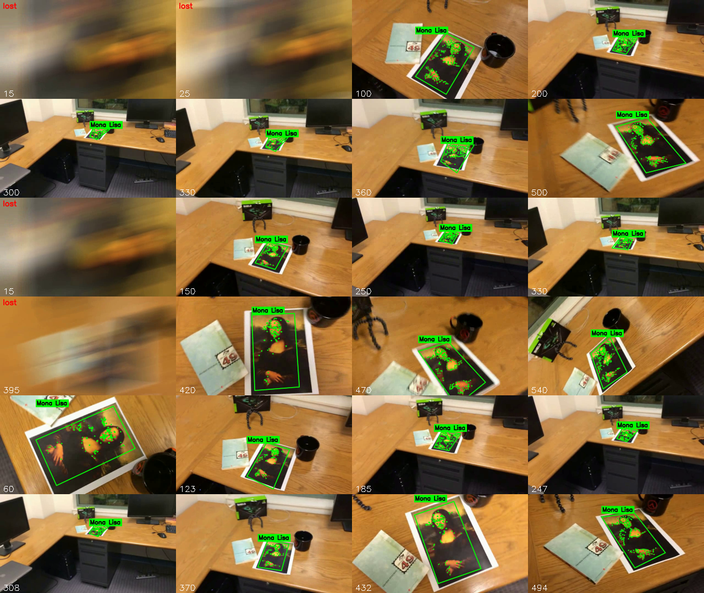
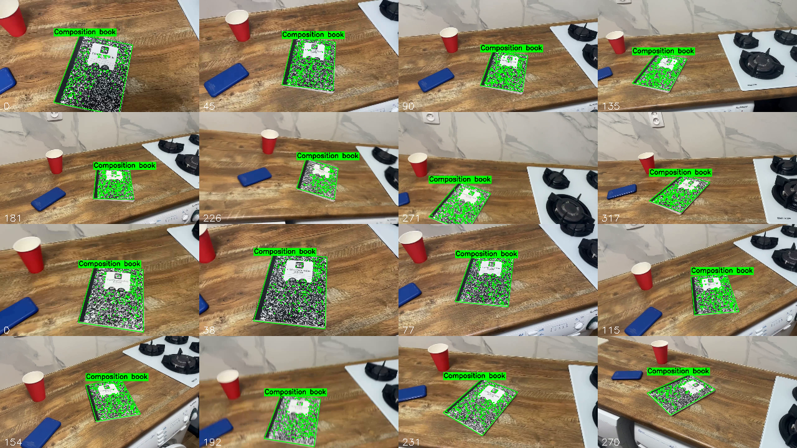

# Трекинг плоского объекта на видео по ключевым точкам

Лабораторная работа: простейший алгоритм трекинга объекта на видео на основе ключевых точек (Python + OpenCV).
Первый кадр видео — крупное изображение объекта; на каждом следующем кадре вокруг объекта рисуется рамка с подписью.

## Запуск

```bash
pip install -r requirements.txt
python tracker.py videos/mona-lisa.avi results/mona-lisa-result.avi --label "Mona Lisa"
python tracker.py videos/mona-lisa-blur.avi results/mona-lisa-blur-result.avi --label "Mona Lisa"
python tracker.py videos/mona-lisa-blur-extra-credit.avi results/mona-lisa-blur-extra-credit-result.avi --label "Mona Lisa"
# собственные видео: первый кадр — вся сцена, поэтому углы объекта задаются через --roi
python tracker.py videos/IMG_8508.MOV results/IMG_8508-result.avi --label "Composition book" --roi 512,222,852,290,762,741,345,658
python tracker.py videos/IMG_8509.MOV results/IMG_8509-result.avi --label "Composition book" --roi 602,272,918,293,922,695,503,632
```

Основные параметры: `--detector {sift,orb,akaze}` (детектор для привязки к эталону), `--points` (число отслеживаемых точек, 250), `--relocalize-every` (период повторной привязки к эталону, 5 кадров), `--recover-frames` (окно восстановления после потери, 90 кадров), `--ratio` (порог Лоу, 0.8), `--min-inliers` (10), `--roi x1,y1,x2,y2,x3,y3,x4,y4` (углы объекта на первом кадре: верхний левый, верхний правый, нижний правый, нижний левый; без параметра объектом считается весь первый кадр), `--log file.csv` (покадровый лог), `--no-points` (не рисовать точки), `--show`.

## 1. Теоретическая база

**Ключевые точки и дескрипторы.** Ключевая точка — локальная область изображения, устойчиво находимая при изменении масштаба, поворота и освещения; для неё вычисляется дескриптор — вектор, описывающий окрестность.
- **SIFT** (Lowe, 2004): экстремумы в пространстве масштабов (разность гауссианов), 128-мерный вещественный дескриптор на гистограммах градиентов. Устойчив к масштабу, повороту и размытию.
- **ORB** (Rublee et al., 2011): FAST-детектор + бинарный BRIEF-дескриптор с ориентацией, быстрый.
- **AKAZE**: бинарный дескриптор на нелинейном пространстве масштабов.

**Сопоставление.** Для каждого дескриптора эталона ищутся два ближайших в кадре (kNN, k=2). Совпадение принимается, если расстояние до лучшего заметно меньше расстояния до второго (ratio test Лоу): `d1 < ratio · d2`.

**Гомография и RANSAC.** Плоский объект при смене положения камеры преобразуется проективным преобразованием `x' ~ H x` (`H` — матрица 3×3, 8 степеней свободы, минимум 4 пары точек). Оценка `H` по соответствиям с выбросами выполняется алгоритмом **RANSAC** (Fischler, Bolles, 1981): случайно выбираются 4 пары, строится `H`, считаются инлайеры по порогу репроекционной ошибки, выбирается модель с максимумом инлайеров.

**Оптический поток Лукаса–Канаде.** Метод оценивает смещение точки между двумя кадрами в предположении постоянства яркости и малого движения в окне вокруг точки (Lucas, Kanade, 1981). Пирамидальная версия (Bouguet) решает задачу на нескольких масштабах изображения и допускает большие смещения. Для отсева ненадёжных треков используется **forward-backward проверка**: точка отслеживается вперёд и обратно, и если она не возвращается в исходное место, трек отбрасывается. Точки для трекинга выбираются детектором Ши–Томаси (`goodFeaturesToTrack`).

## 2. Описание системы

Один модуль `tracker.py`. Идея: ключевые точки **находят** объект по эталону, а оптический поток **ведёт** его от кадра к кадру. Состояние: набор отслеживаемых точек, у каждой известны координаты в эталоне (`ref_pts`) и в текущем кадре (`cur_pts`), и гомография эталон → кадр `H`.

**Инициализация.** Первый кадр — эталон. Если объект занимает весь кадр (тестовые видео с Моной Лизой), его углы совпадают с углами кадра, `H = I`. Если на первом кадре видна вся сцена (собственные видео), углы объекта задаются параметром `--roi`: по четырём углам строится перспективное преобразование первого кадра в прямоугольник (систему координат объекта), ключевые точки и точки для трекинга берутся только внутри этой области, а начальная гомография — обратное к этому преобразованию. Углы могут лежать за пределами кадра, если объект виден не целиком. На эталоне выбираются точки для трекинга (`goodFeaturesToTrack`). Кроме того, для привязки строится пирамида эталона (масштабы 1, 1/2, …, 1/16): ключевые точки со всех уровней приводятся к координатам эталона и объединяются, чтобы объект находился и тогда, когда он в разы меньше первого кадра.

**Для каждого следующего кадра:**
1. **Трекинг.** Точки переносятся на новый кадр оптическим потоком Лукаса–Канаде (с forward-backward проверкой). По уцелевшим точкам RANSAC оценивает новую гомографию `ref → кадр` (порог адаптивный, зависит от размера объекта); точки-выбросы удаляются.
2. **Проверка результата.** Четырёхугольник должен быть выпуклым, с разумными углами и соотношением противоположных сторон, площадью в допустимых пределах и без резкого скачка относительно предыдущего кадра; отслеживаемые точки должны покрывать заметную часть объекта (защита от вырожденной гомографии).
3. **Привязка к эталону.** После потери и периодически (каждые 5 кадров) ключевые точки кадра сопоставляются с эталоном (kNN + ratio test + RANSAC). Это убирает накопленный дрейф и возвращает объект после потери, пока он достаточно крупный.
4. **Восстановление по последнему удачному кадру.** Если объект маленький, по эталону его не найти. Тогда ключевые точки окрестности объекта на последнем удачном кадре (объект в нём в том же масштабе, окно увеличивается) сопоставляются с текущим кадром, и объект находится заново.
5. **Пополнение точек.** По мере ухода точек на объекте (внутри слегка суженного четырёхугольника) детектируются новые; их координаты в эталоне получаются через `H⁻¹`, поэтому объект можно вести сколь угодно долго, в том числе когда он сильно уменьшается или поворачивается.
6. **Вывод.** Рисуются рамка (проекция углов эталона через `H`), отслеживаемые точки и подпись. Если ни трекинг, ни привязка, ни восстановление не сработали, объект считается потерянным (надпись `lost`).

## 3. Результаты тестирования

Тестовые видео: 640×360, 558 кадров, 29.97 fps. Детектор привязки — SIFT, остальные параметры по умолчанию. Скорость обработки на CPU: ≈ 26 fps для видео 640×360 и ≈ 5 fps для видео 1280×720.

| Видео | Кадров | Объект найден | Потеряно (lost) | Ср. число точек |
|---|---|---|---|---|
| mona-lisa.avi | 558 | 558 (100.0%) | 0 | 318 |
| mona-lisa-blur.avi | 558 | 539 (96.6%) | 19 (кадры 10–28) | 240 |
| mona-lisa-blur-extra-credit.avi | 558 | 530 (95.0%) | 28 (кадры 11–29 и 391–399) | 241 |
| IMG_8508.MOV (собственное, 1280×720) | 318 | 318 (100.0%) | 0 | 478 |
| IMG_8509.MOV (собственное, 1280×720) | 271 | 271 (100.0%) | 0 | 461 |

Обзор результатов (строки по две: `mona-lisa-blur`, `mona-lisa-blur-extra-credit`, `mona-lisa`):



Видео с рамками: `results/*.avi`.

**Сравнение с наивным подходом** (только сопоставление с эталоном на каждом кадре, без оптического потока; доля кадров с найденным объектом):

| Видео | Только сопоставление с эталоном (SIFT) | Сопоставление + оптический поток |
|---|---|---|
| mona-lisa.avi | 63.3% | 100.0% |
| mona-lisa-blur.avi | 59.9% | 96.6% |
| mona-lisa-blur-extra-credit.avi | 59.1% | 95.0% |

Наивный подход терял объект, когда тот становился маленьким (около 50–70 px против 640 px на эталоне): на такой области слишком мало ключевых точек, чтобы сопоставить их с эталоном.

**Влияние детектора привязки.** SIFT, ORB и AKAZE дали одинаковый результат (100.0 / 96.6 / 95.0%): объект ведёт оптический поток, а сопоставление с эталоном нужно только для старта и повторной привязки. Различия видны в скорости (ORB быстрее SIFT).

### Наблюдения

- Объект теряется только на кадрах с экстремальным смазом (резкая тряска камеры в начале blur-видео и один быстрый проход в extra-credit), где картина вообще не различима.
- Рамка соответствует участку картины, показанному на первом кадре, так как первый кадр — крупный план части картины, а не весь лист с полями.
- Без проверки формы четырёхугольника и ограничения площади наблюдались «взрывы» рамки: ложное сопоставление давало гигантский четырёхугольник, и оптический поток начинал вести фон. Проверки (углы, соотношение сторон, площадь, разброс точек, скачок между кадрами) это устраняют.

### Собственные видео

Съёмка с руки, 1280×720, 30 fps;

В отличие от тестовых видео, первый кадр здесь не крупный план объекта, а вся сцена, и тетрадь занимает только её часть. Поэтому углы тетради на первом кадре задаются вручную параметром `--roi` (в IMG_8508 нижний край тетради немного выходит за кадр, и нижний правый угол задан за его пределами). Остальной алгоритм не менялся.

| Видео | Кадров | Объект найден | Потеряно (lost) |
|---|---|---|---|
| IMG_8508.MOV | 318 | 318 (100.0%) | 0 |
| IMG_8509.MOV | 271 | 271 (100.0%) | 0 |

Объект находится на всех кадрах, рамка совпадает с границами тетради при изменении масштаба, повороте и перспективе. Кадры результатов (первые две строки — IMG_8508, следующие две — IMG_8509):



Видео с рамками: `results/IMG_8508-result.avi`, `results/IMG_8509-result.avi`.

## 4. Выводы

- Гибрид «ключевые точки + RANSAC-гомография» для обнаружения и пирамидального оптического потока Лукаса–Канаде для сопровождения позволяет держать рамку на плоском объекте при изменении масштаба, повороте и перспективе. Объект находится на 95–100% кадров, причём потери — только на экстремальном смазе.
- Одного сопоставления с эталоном недостаточно (60–63% кадров): при уменьшении объекта совпадений слишком мало. Оптический поток переносит уже найденный объект в маленький масштаб без обращения к эталону.
- Периодическая привязка к эталону предотвращает дрейф, а восстановление по последнему удачному кадру возвращает мелкий объект после кратковременной потери.
- На собственных видео с богатой текстурой (тетрадь) алгоритм работает без потерь (100% кадров); для объекта, который не занимает весь первый кадр, достаточно задать его углы на первом кадре (`--roi`).
- Важна валидация геометрии: без неё одна ложная гомография портит весь дальнейший трекинг.
- Ограничения: плоские текстурированные объекты; при сильном смазе и полной потере текстуры трекинг прерывается; рамка отражает участок эталона, а не весь физический объект.
- Возможные улучшения: сглаживание рамки (фильтр Калмана), предсказание положения при потере, ручная разметка углов объекта на первом кадре.

